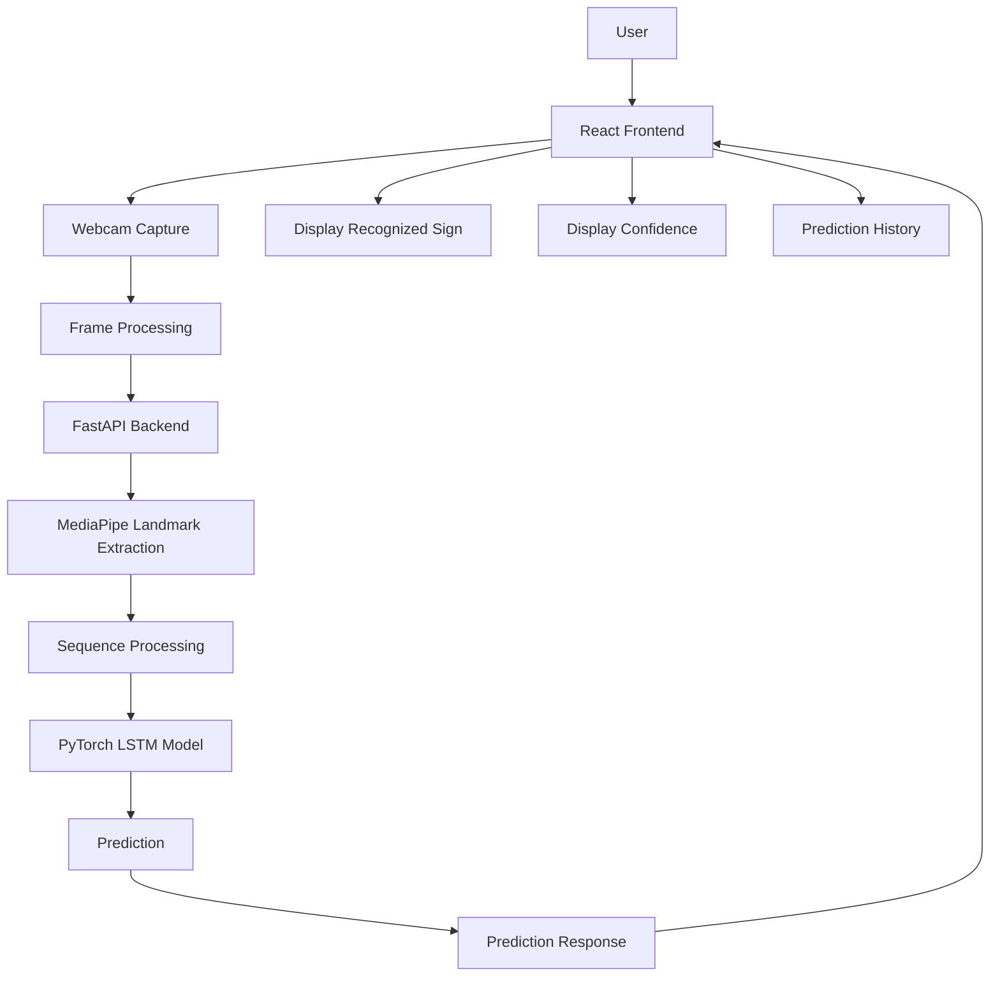

# Real-Time Sign Language Recognition
## System Architecture

### 1. Project Overview

Real-Time Sign Language Recognition is a full-stack machine learning application that recognizes isolated sign language gestures using a webcam and converts them into readable text.

The system uses MediaPipe to extract hand and body landmarks from video frames and a PyTorch-based LSTM model to classify sequences of landmarks into sign language words.

The application consists of three main components:

- **Frontend:** React.js, TypeScript, and Vite
- **Backend:** FastAPI and Python
- **Machine Learning:** MediaPipe, OpenCV, PyTorch, and LSTM

The frontend captures webcam input and communicates with the backend. The backend processes video frames, extracts landmarks, prepares sequences, and generates predictions using the trained model.

### 2. High-Level Architecture



### 3. Project Structure

```text
sign-language-recognition/
│
├── data/
│   ├── raw/
│   ├── processed/
│   └── splits/
│
├── notebooks/
│   ├── 01_dataset_exploration.ipynb
│   ├── 02_landmark_extraction.ipynb
│   ├── 03_model_training.ipynb
│   └── 04_model_evaluation.ipynb
│
├── src/
│   ├── preprocessing/
│   │   ├── video_processor.py
│   │   ├── landmark_extractor.py
│   │   └── sequence_processor.py
│   │
│   ├── models/
│   │   ├── lstm_classifier.py
│   │   └── inference.py
│   │
│   ├── training/
│   │   ├── dataset.py
│   │   ├── train.py
│   │   └── evaluate.py
│   │
│   └── utils/
│       ├── config.py
│       └── visualization.py
│
├── backend/
│   ├── app/
│   │   ├── main.py
│   │   ├── dependencies.py
│   │   │
│   │   ├── api/
│   │   │   ├── routes/
│   │   │   │   ├── health.py
│   │   │   │   └── prediction.py
│   │   │   │
│   │   │   └── schemas/
│   │   │       └── prediction.py
│   │   │
│   │   ├── services/
│   │   │   ├── prediction_service.py
│   │   │   └── landmark_service.py
│   │   │
│   │   └── core/
│   │       └── config.py
│   │
│   ├── tests/
│   │   ├── test_health.py
│   │   └── test_prediction.py
│   │
│   ├── requirements.txt
│   ├── .env.example
│   └── .gitignore
│
├── frontend/
│   ├── public/
│   │
│   ├── src/
│   │   ├── components/
│   │   │   ├── WebcamView.tsx
│   │   │   ├── PredictionDisplay.tsx
│   │   │   ├── ConfidenceDisplay.tsx
│   │   │   └── PredictionHistory.tsx
│   │   │
│   │   ├── pages/
│   │   │   └── Home.tsx
│   │   │
│   │   ├── services/
│   │   │   └── predictionService.ts
│   │   │
│   │   ├── hooks/
│   │   │   └── useWebcam.ts
│   │   │
│   │   ├── types/
│   │   │   └── prediction.ts
│   │   │
│   │   ├── utils/
│   │   ├── App.tsx
│   │   ├── main.tsx
│   │   └── index.css
│   │
│   ├── index.html
│   ├── package.json
│   ├── tsconfig.json
│   ├── tsconfig.app.json
│   ├── tsconfig.node.json
│   ├── vite.config.ts
│   ├── .env.example
│   └── .gitignore
│
├── models/
│   └── .gitkeep
│
├── docs/
│   └── architecture.md
│
├── context.md
├── README.md
├── .gitignore
└── requirements.txt
```

### 4. Component Responsibilities

#### Frontend

The frontend is responsible for:

- Accessing the user's webcam.
- Capturing video frames.
- Sending frames to the backend.
- Displaying recognized sign language words.
- Displaying prediction confidence.
- Maintaining a basic prediction history.
- Showing camera and prediction status.

#### Backend

The backend is responsible for:

- Receiving video frames from the frontend.
- Validating incoming requests.
- Processing frames.
- Extracting landmarks using MediaPipe.
- Preparing landmark sequences.
- Running model inference.
- Returning predictions and confidence scores.

#### Machine Learning

The machine learning component is responsible for:

- Exploring and preparing the WLASL dataset.
- Extracting landmarks from video sequences.
- Preparing fixed-length sequences.
- Training the LSTM classifier.
- Evaluating model performance.
- Loading the trained model for inference.

### 5. Runtime Data Flow

1. The user opens the application.
2. The frontend requests webcam permission.
3. The webcam begins capturing video frames.
4. Frames are sent to the FastAPI backend.
5. MediaPipe extracts relevant landmarks.
6. The backend collects landmarks into a temporal sequence.
7. The sequence is passed to the trained LSTM model.
8. The model predicts the recognized sign.
9. The backend returns the predicted word and confidence score.
10. The frontend displays the prediction.
11. The prediction history updates.

### 6. API Design

#### Health Check

**Endpoint:** `GET /health`

Purpose:

- Verify that the backend is running.
- Check basic application availability.

#### Prediction

**Endpoint:** `POST /predict`

Purpose:

- Receive video frames.
- Process landmarks.
- Generate a sign language prediction.

Example response:

```json
{
  "prediction": "HELLO",
  "confidence": 0.94,
  "status": "success"
}
```

The prediction response may be extended with additional metadata as the application develops.

### 7. Machine Learning Architecture

The initial machine learning pipeline consists of:

1. Dataset exploration.
2. Video preprocessing.
3. Landmark extraction.
4. Sequence preparation.
5. Dataset splitting.
6. LSTM model training.
7. Model evaluation.
8. Model saving.
9. Backend inference.

The initial dataset will use a selected subset of 100 classes from WLASL.

The initial model configuration will use:

- Sequence length: 30 frames.
- Model: LSTM classifier.
- Hidden size: 128.
- LSTM layers: 2.
- Output classes: 100.
- Loss function: Cross Entropy.
- Optimizer: Adam.

These are baseline configuration values and may be adjusted during experimentation.

### 8. Scalability

The architecture is designed to support future improvements, including:

- Increasing the number of sign language classes.
- Improving prediction stability.
- Adding WebSocket-based communication.
- Supporting continuous sign recognition.
- Improving model performance.
- Adding additional language or sign datasets.
- Deploying the frontend and backend separately.

### 9. Reliability and Performance

The system should:

- Handle missing or invalid webcam frames.
- Provide clear camera permission feedback.
- Handle unsuccessful predictions.
- Avoid displaying unstable predictions unnecessarily.
- Maintain consistent landmark sequence dimensions.
- Return meaningful API responses.
- Load the trained model once during backend startup.
- Keep frontend and backend communication efficient.

### 10. Development Order

The project should be developed in the following order:

1. Dataset exploration.
2. Landmark extraction.
3. Sequence preprocessing.
4. LSTM model training.
5. Model evaluation.
6. FastAPI backend development.
7. React frontend development.
8. Frontend-backend integration.
9. Prediction stabilization.
10. Testing and documentation.

### 11. Architecture Principles

- Keep frontend, backend, and machine learning responsibilities separate.
- Use reusable components and services.
- Keep preprocessing consistent between training and inference.
- Use a modular backend architecture.
- Keep model configuration centralized.
- Build the initial system around isolated sign recognition.
- Design the architecture so future features can be added without rebuilding the entire application.

### 12. Conclusion

The proposed architecture provides a modular foundation for a real-time sign language recognition application.

By separating webcam interaction, backend processing, landmark extraction, and model inference, the system remains understandable, maintainable, and extensible.

The initial implementation focuses on isolated sign recognition using a webcam and an LSTM classifier, while leaving room for future improvements such as continuous recognition and more advanced communication methods.
